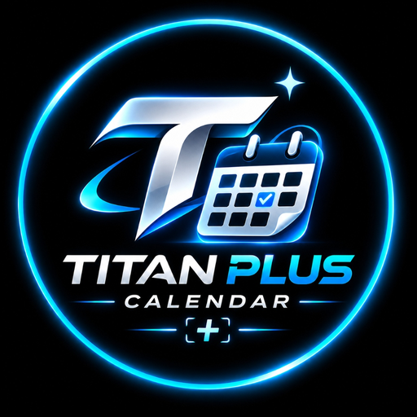

<div align="center">



# 📅 Titan Plus Calendar

### *Premium, 100% Offline Task, Reminder & Notes Management Android App*

[](LICENSE)
[](https://react.dev/)
[](https://www.typescriptlang.org/)
[](https://capacitorjs.com/)
[](https://tailwindcss.com/)
[](https://developer.android.com/)
[](#-100-offline--complete-privacy)

**Titan Plus Calendar** is a modern, high-performance, and privacy-first calendar and productivity application for Android. Designed with a clean, sleek white-card UI and deep purple/neon accents, it delivers complete task management, exact-time reminders, rich day notes, monthly PDF reporting, and secure app locking—**all completely offline with zero server dependencies.**

---

</div>

## 🌟 Key Highlights

- 🔒 **100% Offline & Private:** Zero telemetry, no cloud accounts, and zero internet permissions required. Your data never leaves your device.
- ⏰ **Background & Killed-State Exact Alarms:** Scheduled via native Android `AlarmManager.setExactAndAllowWhileIdle()` and custom high-priority notification channels (`importance: 5`). Reminders trigger reliably even when the app is completely closed or in Doze mode.
- 💾 **Native Device Storage Integration:** One-tap export for Monthly PDF Reports and JSON Data Backups directly into the device's native `Documents` folder with automatic Android Share Sheet trigger.
- 🎨 **3 Adaptive Theme Modes:**
  - **Light (White Card Premium):** High-contrast modern card aesthetic.
  - **Titan Purple:** Rich branded purple accents (`#6C47FF`).
  - **Dark (Night Mode):** Deep OLED-friendly dark palette for nighttime productivity.
- 🔐 **Security & App Lock:** 4-6 digit numeric PIN with interactive on-screen keypad and optional Biometric authentication overlay.
- 📄 **Monthly PDF Reports:** Client-side vector-quality PDF generation for monthly schedules, checklists, and notes with jsPDF.
- 📱 **Native Mobile UX:** Built for full hardware Android Back Button navigation with clean, distraction-free headers.

---

## 📸 Screenshots & Screens Overview

| 1. Monthly Calendar | 2. Day Details & Notes | 3. Settings & Storage |
|:---:|:---:|:---:|
| Interactive grid, Today circle highlight, quick task preview | Checklist with status filter pills, notes card, quick add | Backup to Documents, PDF export, Theme switcher, App Lock |

| 4. Exact-Time Reminder | 5. App Lock (PIN / Biometric) | 6. Monthly PDF Export |
|:---:|:---:|:---:|
| Native notification chime & in-app floating banner | Security keypad overlay with instant protection | Select month & sections, instant PDF generation |

---

## ✨ Features Walkthrough

### 1. 📅 Interactive Monthly Calendar
- Smooth month navigation (`< Nov 2026 >`) with fast jump to Today.
- **Dynamic Today Ring:** Distinct circular indicator around today's date for instant orientation.
- Color-coded indicator dots under dates representing pending or completed tasks.
- Quick preview card for the selected day's schedule directly on the home screen.

### 2. 📝 Day View & Task Management
- Detailed task items with completion toggle, custom tags, and reminder timestamps.
- **Filter Pills:** Switch between `All`, `Pending`, and `Done` with one tap.
- **Day Notes:** Dedicated rich text note card for daily logs, journaling, or meeting minutes.
- Quick actions bottom sheet: *Edit*, *Mark as Done*, *Duplicate*, or *Delete*.
- **Past Date Protection:** Date constraints prevent accidental back-dated task creation.

### 3. 🔔 Exact Alarm & Notification Engine
- Powered by `@capacitor/local-notifications`.
- Configured with high-priority notification channel (`channelId: 'task-reminders'`).
- Custom bundled notification audio (`res/raw/alarm.wav`).
- Dual-tone in-app Web Audio synthesizer for immediate in-app audio chime without network assets.

### 4. 📂 Native File Saving & Backup
- Built on `@capacitor/filesystem` and `@capacitor/share`.
- Automatically requests Android storage permissions when needed.
- Writes files to `Directory.Documents` so users can access files in their file manager (Files / My Files).
- Native Android Share dialog lets users send backups and PDFs to WhatsApp, Drive, Gmail, or Bluetooth immediately.

### 5. 🎨 Custom Branding & Personal Touch
- Custom Titan Plus Calendar branding across app launcher icons, notifications, and web favicons.
- Interactive **"Made by Pushpendra"** celebratory modal in Settings with confetti animation!

---

## 🚀 Pre-Built APK Download

You can install the ready-to-use Android APK directly on any Android 8.0+ (Oreo to Android 15) device:

- **Root APK File:** [`Titan_Plus_Calendar.apk`](./Titan_Plus_Calendar.apk) (8.8 MB)

### Quick Install via ADB:
```bash
adb install -r Titan_Plus_Calendar.apk
```
*Or download/copy the `.apk` file to your Android phone, tap to install, and allow installation from unknown sources.*

---

## 🛠️ Tech Stack & Architecture

- **Core Framework:** [React 19](https://react.dev/) + [TypeScript](https://www.typescriptlang.org/)
- **Bundler & Build Tool:** [Vite 6](https://vitejs.dev/)
- **Styling:** [Tailwind CSS v4](https://tailwindcss.com/)
- **Icons:** [Lucide React](https://lucide.dev/)
- **Mobile Runtime:** [Capacitor 8](https://capacitorjs.com/) (Android Native Bridge)
- **Native Plugins:**
  - `@capacitor/local-notifications` (Exact alarms & notification channels)
  - `@capacitor/filesystem` (Native storage file writes)
  - `@capacitor/share` (System share sheet integration)
  - `@capacitor/app` (Hardware back button handling)
- **PDF Engine:** [jsPDF](https://github.com/parallax/jsPDF)
- **Storage:** LocalStorage & Native File System (100% offline)

---

## 💻 Local Development Setup

### 1. Prerequisites
- **Node.js:** v18.0 or higher
- **npm:** v9.0 or higher
- **Android Studio & SDK:** (For native Android builds with Android SDK Platform 34/35)

### 2. Clone the Repository
```bash
git clone https://github.com/pushpendra-gora/Titan-Plus-Calendar.git
cd Titan-Plus-Calendar
```

### 3. Install Dependencies
```bash
npm install
```

### 4. Run Web Development Server
```bash
npm run dev
```
Open your browser at `http://localhost:3000` (or the port shown in terminal).

### 5. Build Web Assets
```bash
npm run build
```

---

## 🤖 Building the Android App

### 1. Sync Capacitor with Android Project
```bash
npx cap sync android
```

### 2. Build Debug APK with Gradle
```bash
cd android
./gradlew assembleDebug
```
*On Windows Powershell:*
```powershell
cd android
.\gradlew.bat assembleDebug
```

The compiled APK will be generated at:
```
android/app/build/outputs/apk/debug/app-debug.apk
```

### 3. Run directly on Connected Android Device or Emulator
```bash
npx cap run android
```

---

## 🛡️ Privacy & Permissions

Titan Plus Calendar is built strictly with user privacy as the #1 principle:
- ❌ **No Internet Access:** The app does not request `android.permission.INTERNET`.
- ❌ **No Accounts or Logins:** No cloud databases, trackers, or third-party SDKs.
- ✅ **Local Notifications:** `POST_NOTIFICATIONS` and `SCHEDULE_EXACT_ALARM` used strictly for user-created task reminders.
- ✅ **Storage:** Used only when you choose to export a PDF or JSON backup file.

---

## 👨‍💻 Author

Crafted with dedication by **Pushpendra Gora**

- **GitHub:** [@pushpendra-gora](https://github.com/pushpendra-gora)
- **Repository:** [Titan-Plus-Calendar](https://github.com/pushpendra-gora/Titan-Plus-Calendar)

---

## 📄 License

This project is licensed under the [MIT License](LICENSE).
